<a href="https://gavenrobertson.dev">
  
</a>

 

Hey, I'm **Gaven**, a software engineer from Oregon, now based in Montgomery, Alabama. By day I work at **BESPIN**. On the side I run **Webfoot Software Studio**, where I design and build websites for churches and organizations, and I'm working on an M.S. in Computer Science at **Arizona State**.

I like making things that feel good to use: clean front ends, offline-first desktop apps, and the occasional site that's a little weird on purpose.

### ▸ What I'm building

  <a href="https://dragonwarriors.app"></a>
  <a href="https://github.com/gavenrobertson/LineWise"></a>

  <a href="https://github.com/gavenrobertson/MealAtAGlance"></a>
  <a href="https://gavenrobertson.dev"></a>

Code: <a href="https://github.com/gavenrobertson/WoWDragonWarriors">Dragon Warriors</a> · <a href="https://github.com/gavenrobertson/LineWise">LineWise</a> · <a href="https://github.com/gavenrobertson/MealAtAGlance">Meal at a Glance</a> · <a href="https://github.com/gavenrobertson/portfolio-website">gavenrobertson.dev</a>

### ▸ Built for churches and organizations

Through **Webfoot Software Studio** I design and build websites for churches and organizations. A few of them:

  <a href="https://redemptionchurchfamily.com"></a>
  <a href="https://capitalcitychurchofgod.com"></a>

  

### ▸ Stack

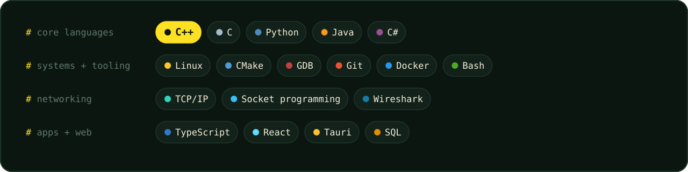

### ▸ Activity


Refreshed every six hours by <a href=".github/workflows/profile.yml">a workflow</a> in this repo. The snake is <a href="https://github.com/Platane/snk">Platane/snk</a>; the stats card is <a href="scripts/build-stats.mjs">hand-rolled</a> to match.

### ▸ Find me

